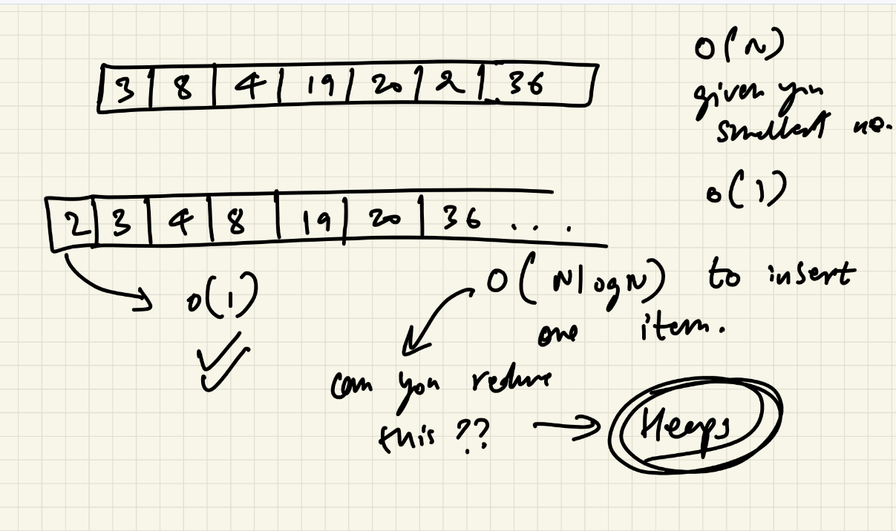
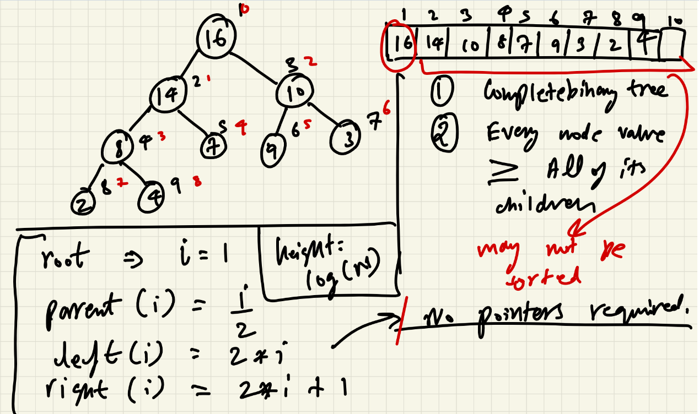
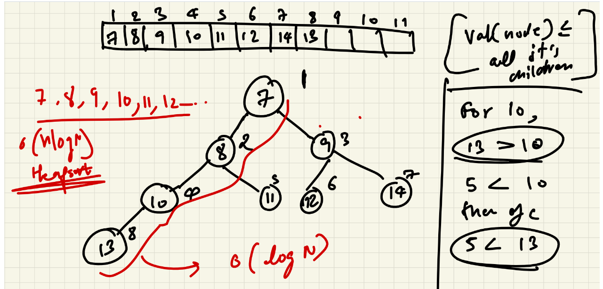
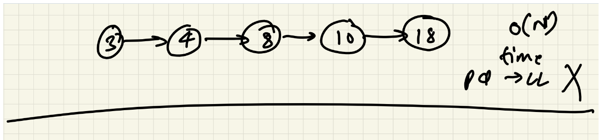
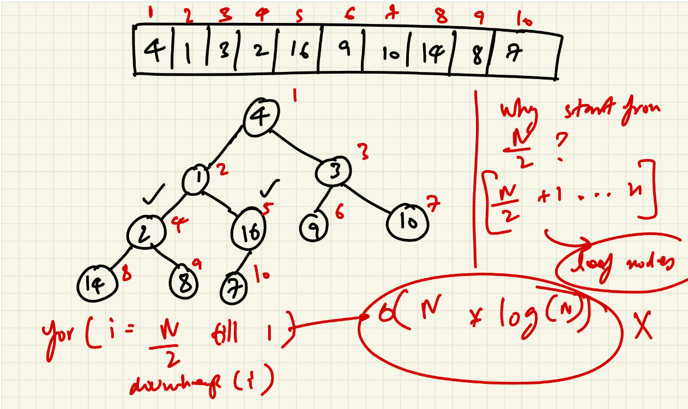
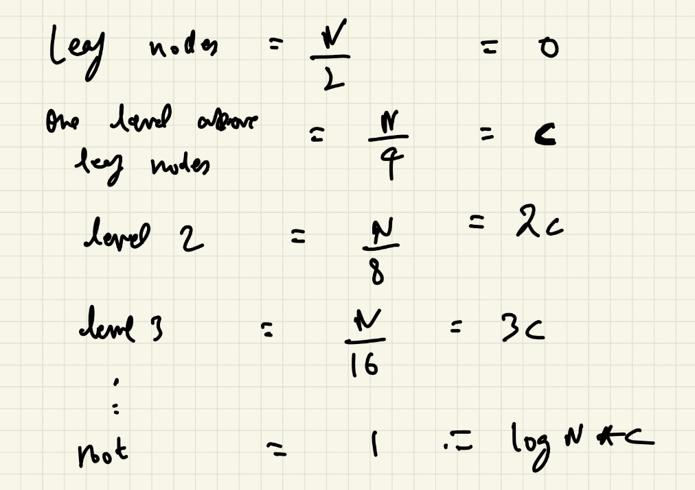
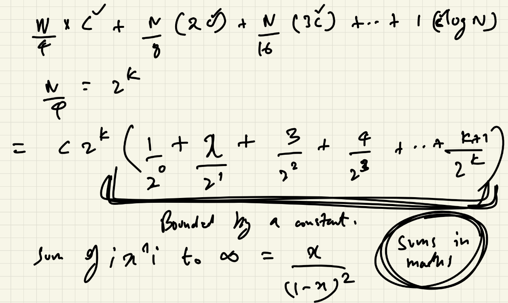
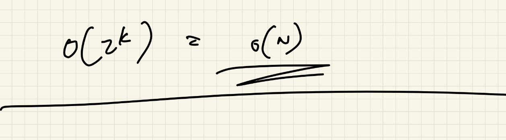

# Heaps --- Lecture Notes










------------------------------------------------------------------------

## 1. Why Heaps?

The main idea behind using a Heap is:

> We have a collection of items, and our main task is to repeatedly get
> an item according to some condition.

Example:

-   Given `n` numbers.
-   We want the **smallest number**.
-   Or we want the **largest number**.
-   The condition could also be something else, such as the smallest age
    of some objects.

### Example from the lecture

Suppose the numbers are:

``` text
3, 8, 4, 19, 20, 2, 36
```

If the only task is:

> Give me the smallest number.

We can store them in an array.

But if the array is unsorted, finding the smallest item requires
searching through the elements.

The lecture shows that if we keep the array sorted, we can get the
smallest item quickly, but inserting a new item becomes expensive
because the array may need to be sorted again.

The goal is therefore:

``` text
Get the required item      → O(1)
Insert a new item          → O(log n)
Remove the required item   → O(log n)
```

This is where **Heap** is useful.

------------------------------------------------------------------------

## 2. Main Idea of a Heap

A Heap allows us to keep the required item at the first position.

For a **Min Heap**:

``` text
Smallest item → first index
```

For a **Max Heap**:

``` text
Largest item → first index
```

Therefore:

``` text
Get minimum / maximum → O(1)
```

The lecture's main point is:

> Whenever the problem gives you a collection of items and asks for the
> smallest/largest item repeatedly, Heap can be useful.

------------------------------------------------------------------------

# 3. How a Heap is Stored

A Heap is:

-   **Stored internally as an Array / ArrayList**
-   **Visualized as a Complete Binary Tree**

It is not actually stored using tree nodes and pointers.

Example from the lecture:

``` text
Array:

16 | 14 | 10 | 8 | 7 | 9 | 3 | 2 | 4
```

Visualized as a tree:

``` text
              16
            /    \
          14      10
         /  \    /  \
        8    7  9    3
       / \
      2   4
```

The values are stored in an array, but we visualize the array as a tree.

------------------------------------------------------------------------

# 4. Complete Binary Tree

A Heap is represented as a **Complete Binary Tree**.

A Complete Binary Tree means:

-   Every level is completely filled except possibly the last level.
-   The last level is filled **from left to right**.

Example:

``` text
              16
            /    \
          14      10
         /  \    /  \
        8    7  9    3
       / \
      2   4
```

The last level starts filling from the left:

``` text
        2
         \
          4
```

There are no gaps before a node on the last level.

------------------------------------------------------------------------

# 5. Heap Property

There are two important types.

## Min Heap

In a Min Heap:

``` text
Every node value <= all of its children
```

So the smallest value is at the root.

Example:

``` text
              7
            /   \
           8     9
          / \   / \
        10 11 12 14
```

Here:

``` text
7 <= 8, 9
8 <= 10, 11
9 <= 12, 14
```

Therefore the root contains the minimum value.

------------------------------------------------------------------------

## Max Heap

In a Max Heap:

``` text
Every node value >= all of its children
```

Example:

``` text
              16
            /    \
          14      10
         /  \    /  \
        8    7  9    3
       / \
      2   4
```

Here:

``` text
16 >= 14, 10
14 >= 8, 7
10 >= 9, 3
8 >= 2, 4
```

Therefore the root contains the maximum value.

------------------------------------------------------------------------

# 6. Heap is NOT a Sorted Array

This is important.

A Heap does **not** mean that the complete array is sorted.

Example:

``` text
16 | 14 | 10 | 8 | 7 | 9 | 3 | 2 | 4
```

This is not sorted.

But it is still a valid Max Heap because every parent is greater than or
equal to its children.

The important condition is:

``` text
Parent >= Children     → Max Heap

Parent <= Children     → Min Heap
```

The lecture emphasizes that the main concern is that the required item
is at the first index.

------------------------------------------------------------------------

# 7. Array Representation of a Heap

The lecture first uses **1-based indexing** for understanding.

Example:

``` text
Index:  1   2   3   4   5   6   7   8   9
        |   |   |   |   |   |   |   |   |
Value: 16  14  10   8   7   9   3   2   4
```

Tree:

``` text
                 16 (1)
               /        \
          14 (2)        10 (3)
          /   \          /   \
      8 (4) 7 (5)    9 (6) 3 (7)
       / \
    2 (8) 4 (9)
```

------------------------------------------------------------------------

# 8. Parent, Left and Right Index Formulas

For **1-based indexing**:

### Parent

``` text
parent(i) = i / 2
```

Integer division is used.

Examples:

``` text
parent(5) = 5 / 2 = 2

parent(8) = 8 / 2 = 4

parent(9) = 9 / 2 = 4

parent(7) = 7 / 2 = 3
```

------------------------------------------------------------------------

### Left Child

``` text
left(i) = 2 * i
```

Examples:

``` text
left(1) = 2
left(2) = 4
left(3) = 6
left(4) = 8
```

------------------------------------------------------------------------

### Right Child

``` text
right(i) = 2 * i + 1
```

Examples:

``` text
right(1) = 3
right(2) = 5
right(3) = 7
right(4) = 9
```

------------------------------------------------------------------------

# 9. Why No Pointers Are Required

Because the Heap is stored in an array, we don't need:

``` text
left pointer
right pointer
parent pointer
```

The index formulas tell us where the parent and children are.

For 1-based indexing:

``` text
Parent → i / 2
Left   → 2i
Right  → 2i + 1
```

------------------------------------------------------------------------

# 10. 0-Based Indexing

In the actual Java code, the lecture uses an `ArrayList`, so indexing
starts from `0`.

For 0-based indexing:

``` text
Parent = (i - 1) / 2

Left   = 2 * i + 1

Right  = 2 * i + 2
```

Example:

``` text
Index:  0   1   2   3   4   5   6   7   8
Value:  7   8   9  10  11  12  14  13  ...
```

For index `0`:

``` text
left(0)  = 2(0) + 1 = 1
right(0) = 2(0) + 2 = 2
```

For index `1`:

``` text
left(1)  = 3
right(1) = 4
```

For index `2`:

``` text
left(2)  = 5
right(2) = 6
```

------------------------------------------------------------------------

# 11. Inserting an Element into a Heap

The lecture explains insertion using a **Min Heap**.

Suppose we have:

``` text
8
```

Then insert:

``` text
7
```

Because it is a Complete Binary Tree, the new element is first inserted
at the next available position.

``` text
        8
       /
      7
```

Array:

``` text
8 | 7
```

But this violates the Min Heap property because:

``` text
7 < 8
```

So we swap them:

``` text
        7
       /
      8
```

Array:

``` text
7 | 8
```

------------------------------------------------------------------------

# 12. Up Heap

When inserting an element:

1.  Put the element at the last index.
2.  Check its parent.
3.  If the Heap property is violated, swap.
4.  Continue moving upward.

This process is called:

``` text
Up Heap
```

or

``` text
Upheap
```

The element moves:

``` text
Bottom → Top
```

Example:

``` text
Before:

        10
       /  \
      12   13
     /
    5
```

Since:

``` text
5 < 12
```

for a Min Heap, swap:

``` text
        10
       /  \
      5    13
     /
    12
```

Continue checking the new parent.

------------------------------------------------------------------------

# 13. Why Insertion is O(log n)

During insertion, the new element can move upward only one level at a
time.

A Complete Binary Tree has height:

``` text
O(log n)
```

Therefore, the number of comparisons/swaps is at most proportional to
the height.

Hence:

``` text
Insertion = O(log n)
```

The lecture describes this as:

``` text
One check per level
×
log n levels

= O(log n)
```

------------------------------------------------------------------------

# 14. Removing an Element from a Heap

For the Heap operations discussed in the lecture, the important removal
is removal of the root.

For a Min Heap:

``` text
Remove minimum
```

The minimum is at index `0`.

Example:

``` text
        7
       / \
      8   9
     / \ / \
   10 11 12 14
```

Remove:

``` text
7
```

Now the root position is empty.

The lecture's method is:

1.  Take the last element.
2.  Put it at the root.
3.  Remove the last position.
4.  Fix the Heap by moving the root downward.

Example:

``` text
Last element = 14
```

Put it at the root:

``` text
        14
       /  \
      8    9
     / \  / \
   10 11 12
```

Now the Heap property is violated.

------------------------------------------------------------------------

# 15. Down Heap

After removing the root:

1.  Start from the root.
2.  Look at the left and right children.
3.  Find the smaller child in a Min Heap.
4.  If that child is smaller than the current node, swap.
5.  Continue downward.

This is called:

``` text
Down Heap
```

or

``` text
Downheap
```

The movement is:

``` text
Top → Bottom
```

------------------------------------------------------------------------

# 16. Choosing the Correct Child During Down Heap

Suppose:

``` text
        14
       /  \
      8    9
```

For a Min Heap:

``` text
8 < 9
```

So compare with `8`.

``` text
        8
       / \
     14   9
```

Then continue checking from the new position of `14`.

The lecture specifically says:

> Check which one is smaller --- left or right --- and swap with the
> smaller one.

------------------------------------------------------------------------

# 17. Why We Do Not Check the Other Side After Swapping

Suppose we have:

``` text
        10
       /  \
      7    9
```

For a Min Heap, `7` is smaller than `10`, so swap:

``` text
        7
       /  \
     10    9
```

We continue downward from the position where `10` moved.

We do not need to go back and compare with the other branch because the
Heap property in the unaffected branch was already satisfied.

------------------------------------------------------------------------

# 18. Down Heap Complexity

A node can move downward only one level at a time.

The height of a Complete Binary Tree is:

``` text
O(log n)
```

Therefore:

``` text
Down Heap = O(log n)
```

------------------------------------------------------------------------

# 19. Insert and Remove Complexity

``` text
Operation          Complexity
--------------------------------
Get root           O(1)
Insert             O(log n)
Remove root        O(log n)
```

The lecture focuses on:

``` text
Get required item → O(1)
Insert            → O(log n)
Remove            → O(log n)
```

------------------------------------------------------------------------

# 20. Heap Implementation in Java

The lecture uses:

``` java
ArrayList
```

instead of an array to make the implementation simpler.

The Heap is also made generic:

``` java
T extends Comparable<T>
```

This allows objects of type `T` to be compared.

The lecture explains that this is needed because the Heap needs to
compare two objects.

------------------------------------------------------------------------

# 21. Heap Code --- ArrayList + Generics

``` java
import java.util.ArrayList;

public class Heap<T extends Comparable<T>> {

    private ArrayList<T> list;

    public Heap() {
        list = new ArrayList<>();
    }

    private void swap(int first, int second) {

        T temp = list.get(first);

        list.set(first, list.get(second));

        list.set(second, temp);
    }

    private int parent(int index) {
        return (index - 1) / 2;
    }

    private int left(int index) {
        return index * 2 + 1;
    }

    private int right(int index) {
        return index * 2 + 2;
    }

    public void insert(T value) {

        // Add the value at the last index
        list.add(value);

        // Move it upward if required
        upHeap(list.size() - 1);
    }

    private void upHeap(int index) {

        // If we are at the root, stop
        if (index == 0) {
            return;
        }

        int p = parent(index);

        // For Min Heap:
        // If current element is smaller than parent,
        // swap them.
        if (list.get(index).compareTo(list.get(p)) < 0) {

            swap(index, p);

            // Continue checking from the parent
            upHeap(p);
        }
    }

    public T remove() throws Exception {

        // Removing from an empty Heap is not allowed
        if (list.isEmpty()) {
            throw new Exception("Removing from an empty Heap");
        }

        // Root element is the minimum element
        T temp = list.get(0);

        // Take the last element
        T last = list.remove(list.size() - 1);

        // If Heap is not empty after removal
        if (!list.isEmpty()) {

            // Put the last element at the root
            list.set(0, last);

            // Restore Heap property
            downHeap(0);
        }

        return temp;
    }

    private void downHeap(int index) {

        // Assume current index is the minimum
        int min = index;

        int left = left(index);
        int right = right(index);

        // Check left child
        if (left < list.size()) {

            if (list.get(min).compareTo(list.get(left)) > 0) {
                min = left;
            }
        }

        // Check right child
        if (right < list.size()) {

            if (list.get(min).compareTo(list.get(right)) > 0) {
                min = right;
            }
        }

        // If a smaller child was found
        if (min != index) {

            swap(min, index);

            // Continue downward
            downHeap(min);
        }
    }

    public ArrayList<T> heapSort() throws Exception {

        ArrayList<T> data = new ArrayList<>();

        // Keep removing until Heap becomes empty
        while (!list.isEmpty()) {

            data.add(remove());
        }

        return data;
    }
}
```

> **Note:** The lecture's implementation is a **Min Heap**, because the
> root is repeatedly removed as the minimum item.

------------------------------------------------------------------------

# 22. Heap Sort

The lecture describes Heap Sort very simply:

> Keep removing elements from the Heap while the Heap is not empty and
> put the removed elements into another list.

For a Min Heap:

``` text
Remove 7
Remove 8
Remove 9
Remove 10
Remove 11
Remove 12
Remove 13
Remove 14
```

The resulting list is sorted:

``` text
7 → 8 → 9 → 10 → 11 → 12 → 13 → 14
```

------------------------------------------------------------------------

# 23. Heap Sort Code from the Lecture

The lecture's idea is:

``` java
public ArrayList<T> heapSort() throws Exception {

    ArrayList<T> data = new ArrayList<>();

    while (!list.isEmpty()) {

        data.add(remove());
    }

    return data;
}
```

The idea is simply:

``` text
Heap
 ↓
remove()
 ↓
smallest element
 ↓
put into data
 ↓
remove()
 ↓
next smallest
 ↓
...
```

------------------------------------------------------------------------

# 24. Heap Sort Complexity

One removal:

``` text
O(log n)
```

If there are `n` elements:

``` text
n × O(log n)
```

Therefore:

``` text
Heap Sort = O(n log n)
```

The lecture describes it as:

``` text
Remove n items
×
O(log n) per removal

= O(n log n)
```

------------------------------------------------------------------------

# 25. Priority Queue

The lecture explains that the Heap implementation itself is essentially
giving us a **Priority Queue**.

Example:

``` text
Priority = minimum item
```

Then:

``` text
remove() → minimum item
```

So a Min Heap can implement a priority queue where the smallest item has
the highest priority.

------------------------------------------------------------------------

# 26. Priority Queue Using Linked List

The lecture also briefly discusses another way to implement a Priority
Queue using a linked list.

Example:

``` text
3 → 4 → 8 → 18
```

Suppose we insert:

``` text
10
```

We traverse until we find the correct position:

``` text
3 < 10
4 < 10
8 < 10
18 > 10
```

So `10` is inserted before `18`:

``` text
3 → 4 → 8 → 10 → 18
```

The problem:

``` text
Insertion = O(n)
```

because a linked list must be traversed one node at a time.

The lecture therefore prefers Heap:

``` text
Heap insertion = O(log n)
```

------------------------------------------------------------------------

# 27. Creating a Heap from an Unsorted Array

The lecture then considers:

> Given an unsorted array, create a Max Heap.

Example:

``` text
4, 1, 3, 2, 16, 9, 10, 14, 8, 7
```

Using 1-based indexing:

``` text
Index:  1  2  3  4   5  6   7   8  9  10
Value:  4  1  3  2  16  9  10  14  8   7
```

Tree:

``` text
                 4
              /     \
             1       3
           /  \     /  \
          2   16   9   10
         / \  / \
       14  8 7
```

The goal is to make every parent:

``` text
>= its children
```

------------------------------------------------------------------------

# 28. Why We Start from n/2

Leaf nodes do not have children.

Therefore, there is nothing to Heapify for a leaf.

In a Complete Binary Tree, the leaf nodes are approximately the second
half of the array.

For:

``` text
n = 10
```

the lecture starts from:

``` text
n / 2 = 5
```

and works backward:

``` text
5 → 4 → 3 → 2 → 1
```

So:

``` text
for i = n/2 down to 1
    downHeap(i)
```

The lecture's point is that we skip all leaf nodes because there is
nothing below them to fix.

------------------------------------------------------------------------

# 29. Build Heap --- Basic Idea

For every non-leaf node:

``` text
Call downHeap()
```

Starting from:

``` text
n / 2
```

and moving toward:

``` text
1
```

Conceptually:

``` text
for i = n/2 to 1
    downHeap(i)
```

For the example with `n = 10`:

``` text
downHeap(5)
downHeap(4)
downHeap(3)
downHeap(2)
downHeap(1)
```

After applying this, the array becomes a Max Heap.

------------------------------------------------------------------------

# 30. Build Heap Time Complexity

At first glance, it may look like:

``` text
n/2 nodes × O(log n)
```

which gives:

``` text
O(n log n)
```

But the lecture explains that this is **not** the actual complexity.

The reason is that all nodes do not have height `log n`.

Nodes near the leaves move only a small distance.

------------------------------------------------------------------------

# 31. Work Done at Different Levels

For the level just above the leaf nodes:

``` text
Number of nodes ≈ n/4
```

Each takes constant work:

``` text
C
```

So:

``` text
n/4 × C
```

For the next level:

``` text
Number of nodes ≈ n/8
```

Each can move about 2 levels:

``` text
2C
```

So:

``` text
n/8 × 2C
```

Next:

``` text
n/16 × 3C
```

And so on.

At the root:

``` text
1 × log(n)C
```

So the total work is of the form:

``` text
n/4 × C
+
n/8 × 2C
+
n/16 × 3C
+
...
+
1 × log(n)C
```

------------------------------------------------------------------------

# 32. Why Build Heap is O(n)

The lecture then uses the mathematical series:

``` text
1/2 + 2/4 + 3/8 + 4/16 + ...
```

The important point from the lecture is that this series is bounded by a
constant.

The lecture writes the sum in the form:

``` text
Σ i x^i
```

and uses the mathematical result:

``` text
Σ(i x^i) = x / (1 - x)^2
```

for the relevant bounded value of `x`.

Therefore, the total work becomes:

``` text
O(2^k)
```

and since:

``` text
2^k = O(n)
```

the final complexity is:

``` text
Build Heap = O(n)
```

### Important interview point

Do **not** simply say:

``` text
n/2 × log n = O(n log n)
```

for the standard bottom-up Build Heap.

The lecture specifically explains why the actual complexity is:

``` text
O(n)
```

------------------------------------------------------------------------

# 33. Heap Lecture --- Complexity Summary

``` text
Get minimum / maximum      → O(1)

Insert into Heap            → O(log n)

Remove root                 → O(log n)

Down Heap                   → O(log n)

Up Heap                     → O(log n)

Heap Sort                   → O(n log n)

Build Heap from array       → O(n)
```

------------------------------------------------------------------------

# 34. Complete Heap Picture

``` text
                         HEAP
                           |
             +-------------+-------------+
             |                           |
         Min Heap                     Max Heap
             |                           |
      Parent <= Child             Parent >= Child
             |                           |
      Minimum at root             Maximum at root
             |                           |
             +-------------+-------------+
                           |
                   Complete Binary Tree
                           |
                    Stored as Array
                           |
             +-------------+-------------+
             |                           |
        1-based indexing            0-based indexing
             |                           |
       Parent = i/2                 Parent = (i-1)/2
       Left   = 2i                  Left   = 2i+1
       Right  = 2i+1                Right  = 2i+2
```

------------------------------------------------------------------------

# 35. Key Things to Remember

### Heap is not a BST

Heap only guarantees the parent-child relationship:

``` text
Min Heap:
Parent <= Children

Max Heap:
Parent >= Children
```

It does **not** make the entire structure sorted.

### Heap is a Complete Binary Tree

``` text
All levels full
except possibly last

Last level → filled left to right
```

### Heap is stored as an Array

No tree pointers are required.

### Insertion

``` text
Add at last
↓
Up Heap
↓
O(log n)
```

### Removal

``` text
Remove root
↓
Move last element to root
↓
Down Heap
↓
O(log n)
```

### Heap Sort

``` text
Keep removing root
↓
Put removed elements into another list
↓
O(n log n)
```

### Build Heap

``` text
Start from n/2
↓
Move backward toward root
↓
Down Heap each non-leaf
↓
O(n)
```

------------------------------------------------------------------------

# 36. Lecture's Main Takeaway

The lecture's overall progression is:

``` text
Why Heap?
   ↓
Need minimum / maximum quickly
   ↓
Heap structure
   ↓
Complete Binary Tree
   ↓
Heap Property
   ↓
Array Representation
   ↓
Parent / Left / Right formulas
   ↓
Insertion
   ↓
Up Heap
   ↓
Removal
   ↓
Down Heap
   ↓
Heap Sort
   ↓
Priority Queue
   ↓
Build Heap from Unsorted Array
   ↓
Build Heap = O(n)
```

The lecture emphasizes that Heap is a relatively straightforward topic
once these few patterns are understood.
